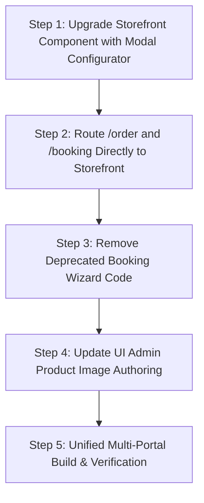

# 🛍️ Modern E-Commerce Storefront Transformation & Marketplace Elimination Plan
**Version 4.0 | Eliminating the Multi-Step "Booking Wizard" & Deploying a Pure Visual E-Commerce Storefront**
*WeddingAlbums.in · Image-Driven Storefront · Per-Sheet Engine · Dynamic CMS Management · B2B Trade Portal*

---

## 1. Executive Summary: The Core Transformation Mandate

### The Problem Identified:
In `client`, the current `/booking` and `/order` pages still feature a legacy 4-step service marketplace questionnaire:
```
  [Step 1: Pick Services] ──▶ [Step 2: Customization] ──▶ [Step 3: Event Details] ──▶ [Step 4: Upload & Confirm]
  "All Editing, Video & Printing Services in One Place... Choose pure digital editing, pure lab printing..."
  "1 Services Selected ... Next: Customize Selected Services"
```
This multi-step wizard is typical of a freelance gig agency or service marketplace lead-funnel. **It is NOT an e-commerce storefront.**

### The Target Solution: Pure Visual E-Commerce Storefront
Replace the multi-step questionnaire entirely with a **real, visual e-commerce storefront**:
- **Visual Product Catalog**: Every single album format, paper substrate, video editing package, and flex banner is displayed as a distinct product with **high-resolution images**, live **Per-Sheet pricing**, and specifications.
- **Instant Category & Orientation Filters**: Filter instantly by `All Products`, `Landscape Albums ↔️`, `Portrait Albums ↕️`, `Paper Substrates`, `Video Editing`, `WhatsApp Video Invites`, and `Flex Banners`.
- **Direct 1-Click Purchase & Customization**:
  - **Quick Add to Cart**: Adds the default 30-sheet base album or service directly to the Cart Drawer in 1 click.
  - **Configure & Book Modal**: A sleek, instant product detail modal where customers can adjust sheets (live counter/slider from 20 to 80 sheets with dynamic `₹/sheet` math), select paper substrate, pick a luxury master cover, attach their Google Drive link, and click **"Add to Cart"** or **"Buy Now"**.
- **Unified Cart & Checkout**: Slide-out cart drawer (`CartDrawer.jsx`), dedicated Cart page (`/cart`), and 1-page Checkout (`/checkout`).
- **Complete Dynamic CMS Control (`uiadmin`)**: Admin can manage, add, edit, or delete any product, image URL, dimensions, retail price, studio wholesale price, and description directly from the admin panel.

---

## 2. Architectural Comparison: Old Wizard vs New Visual Storefront

```
                                  OLD MARKETPLACE WIZARD (REMOVED)
  [User visits /order or /booking]
                 │
                 ▼
     [Step 1: Pick Services] ── (Checkboxes: Karizma, Video, Retouch, Flex...)
                 │
                 ▼
     [Step 2: Customization] ── (Dense technical forms, substrate dropdowns...)
                 │
                 ▼
     [Step 3: Event Details] ── (Muhurtham date, city, delivery speed...)
                 │
                 ▼
     [Step 4: Upload & Confirm] ── (Submit order to internal queue)

                                                ▼
                            NEW VISUAL E-COMMERCE STOREFRONT (TARGET)
  [User visits Storefront (/shop, /order, /booking)]
                 │
                 ▼
  ┌────────────────────────────────────────────────────────────────────────────────────────┐
  │  VISUAL PRODUCT GRID WITH FILTER BAR (Images · Dimensions · Per-Sheet Price Badges)    │
  │  [All] [↔️ Landscape Albums] [↕️ Portrait Albums] [Paper Finishes] [Video] [Flex]     │
  └───────────────────────────────┬────────────────────────────────────────────────────────┘
                                  │
         ┌────────────────────────┴────────────────────────┐
         │                                                 │
         ▼                                                 ▼
   [Quick Add]                                    [Configure & Book]
   (Adds 30-sheet base                            (Opens Sleek Product Drawer)
    album directly to cart)                       • Adjust Sheets (e.g. 35 Sheets = Base + 5 × Rate)
         │                                        • Choose Paper Finish (e.g. Royal Velvet)
         │                                        • Choose Master Cover (e.g. Acrylic 3D Glass)
         │                                        • Upload Drive Link (optional)
         │                                        • Click "Add to Cart" or "Buy Now"
         │                                                 │
         └────────────────────────┬────────────────────────┘
                                  │
                                  ▼
                     [Slide-Out Cart Drawer]
                     • Shows itemized album specs, sheets, finish, and live subtotal
                     • "Proceed to Checkout" button
                                  │
                                  ▼
                     [Instant 1-Page Checkout (/checkout)]
                     • Shipping Address & Couple Details
                     • Order confirmation & live order tracking (/track)
```

---

## 3. The 5 Product Categories in the Visual Storefront

Every product in the catalog is rendered with **real photography/mockups**, exact dimensions, and transparent pricing:

### Category 1: Heirloom Wedding Albums (Per-Sheet Pricing)
*Categorized into Landscape (↔️ Panoramic Lay-Flat) and Portrait (↕️ Royal Magazine).*

| Product Name | Format | Dimensions | Image Mockup | Retail Per-Sheet | 30-Sheet Base Price | Studio Wholesale |
|---|---|---|---|---|---|---|
| **12×36 Grand Imperial** ⭐ | Landscape | 12" × 36" (Closed 18×12) | `/images/mockup-layflat-spread.svg` | **₹260 / sheet** | ₹9,500 | ₹180 / sheet (₹7,800) |
| **14×40 Magnum Maharaja** | Landscape | 14" × 40" (Closed 20×14) | `/images/opt/weddingalbums-home-herow1600.webp` | **₹550 / sheet** | ₹16,500 | ₹350 / sheet (₹10,500) |
| **12×30 Classic Panoramic** | Landscape | 12" × 30" (Closed 15×12) | `/images/mockup-layflat-spread.svg` | **₹230 / sheet** | ₹8,500 | ₹155 / sheet (₹6,800) |
| **10×30 Slim Cinema** | Landscape | 10" × 30" (Closed 15×10) | `/images/cinematic.jpg` | **₹210 / sheet** | ₹7,800 | ₹145 / sheet (₹5,900) |
| **15×30 Royal Square Jumbo** | Landscape | 30" × 15" (Closed 15×15) | `/images/mockup-layflat-spread.svg` | **₹320 / sheet** | ₹13,200 | ₹210 / sheet (₹8,500) |
| **12×24 Celebration Square** | Landscape | 12" × 24" (Closed 12×12) | `/images/mockup-layflat-spread.svg` | **₹200 / sheet** | ₹7,500 | ₹140 / sheet (₹5,400) |
| **18×12 Grand Vertical** ⭐ | Portrait | 18"H × 24"W (Closed 12×18)| `/images/bride-polished.jpg` | **₹240 / sheet** | ₹9,000 | ₹165 / sheet (₹6,200) |
| **15×12 Classic Vertical** | Portrait | 15"H × 24"W (Closed 12×15)| `/images/bridal.jpg` | **₹210 / sheet** | ₹7,800 | ₹145 / sheet (₹5,400) |
| **14×11 Fine Art Editorial** | Portrait | 14"H × 22"W (Closed 11×14)| `/images/bride-polished.jpg` | **₹190 / sheet** | ₹7,200 | ₹135 / sheet (₹4,900) |
| **6×9 Parent Companion** | Landscape | 6" × 18" (Closed 9×6) | `/images/mockup-layflat-spread.svg` | **₹105 / sheet** | ₹3,200 | ₹70 / sheet (₹2,100) |

---

### Category 2: Paper Finishes & Substrates
*Displayed with high-texture sample swatches and tactile upgrade rates.*
- **NTR Anti-Glare Matte**: 100% waterproof synthetic polymer (Included in Base Price — ₹0 Extra)
- **24K Metallic Pearl Gold**: Shimmer finish for bridal jewelry & zardozi (+₹25 Retail / +₹18 Studio)
- **Royal Velvet Feather Touch**: Scuff-free ultra-matte with soft-touch glide (+₹35 Retail / +₹22 Studio)
- **Pure Silk Pattu Weave**: Woven silk saree texture (+₹45 Retail / +₹25 Studio)
- **Sparkle Diamond Glitter**: Multi-angle crystal sparkle (+₹50 Retail / +₹32 Studio)
- **Silver Halide True Chemical Fuji DP2**: Archival continuous-tone lab print (+₹40 Retail / +₹25 Studio)

---

### Category 3: Cinematic Video Editing
*All regional events: Telugu Pelli, Langa Voni, Sreemantham, Birthdays, Receptions.*
- **Instagram Reels & Shorts 5-Pack (9:16)**: Retail **₹3,500** | Studio **₹2,100**
- **4K Cinematic Wedding Teaser (1–3 min)**: Retail **₹6,000** | Studio **₹3,600**
- **Story Highlights Film (10–15 min)**: Retail **₹10,000** | Studio **₹6,200**
- **Full Traditional Multi-Cam Documentary (2–3 hrs)**: Retail **₹12,000** | Studio **₹7,500**
- **Same-Day Edit (SDE) Reception Screening**: Retail **₹12,000** | Studio **₹8,000**
- **Pre-Wedding Love Story Film**: Retail **₹5,000** | Studio **₹3,200**

---

### Category 4: WhatsApp Digital Invites & Event Flex Designing
- **60s Animated 4K WhatsApp Video Invitation**: Retail **₹1,999** | Studio **₹950**
- **Interactive Multi-Slide PDF & Carousel Card**: Retail **₹999** | Studio **₹500**
- **Welcome Roll-Up Retractable Standee (6×3 ft)**: Retail **₹1,800** | Studio **₹850**
- **Grand Mandap Entrance Flex Banner (10×8 ft)**: Retail **₹2,400** | Studio **₹1,100**
- **Stage Backdrop Banner (20×10 ft)**: Retail **₹5,500** | Studio **₹2,800**
- **Tabletop 12-Month Desk Calendar**: Retail **₹1,200** | Studio **₹650**

---

## 4. UI Admin CMS: Dynamic Product & Image Management

In [`HubCatalogEditor.jsx`](file:///c:/Users/manoj/Desktop/weddingalbum/uiadmin/src/pages/HubCatalogEditor.jsx), the admin has full CRUD power over the entire Storefront:
1. **Product Images**: Admin can paste or select image URLs for every album size, finish swatch, video thumbnail, and flex banner.
2. **Pricing & Per-Sheet Rates**: Live fields for Retail Per-Sheet Price, Studio Wholesale Per-Sheet Price, 30-Sheet Base Price, and Cover Upgrades.
3. **Product Information**: Edit Title, Telugu Subtitle, Dimensions, Open Spread, Turnaround Time, and Best Seller Badges.
4. **Publishing**: 1-click publishing updates `client/public/content.json` and backend database in real time.

---

## 5. Implementation Roadmap to Replace the Booking Wizard



### Action Items & Deliverables:
- [ ] **Action 1**: Upgrade `client/src/pages/Shop.jsx` with an **Interactive Product Configurator Modal**:
  - Clicking "Customize & Book" on any album opens an instant sheet-by-sheet configurator with:
    - Sheet counter / slider (20 to 80 sheets) with real-time price math.
    - Paper finish selector (NTR Matte, Metallic Gold, Royal Velvet, Silk Pattu).
    - Luxury Cover selector (Acrylic 3D Glass, Velvet Debossed, Italian Leatherette).
    - RAW Drive Link / Cloud Link input.
    - "Add to Cart" and "Buy Now / Checkout" buttons.
- [ ] **Action 2**: Re-route `/order` and `/booking` in `client/src/App.jsx` to render the **Visual E-Commerce Storefront**:
  - Eliminate the multi-step questionnaire (`Pick Services -> Customization -> Event Details -> Upload & Confirm`).
  - When visiting `/order?size=12x36`, the storefront automatically opens the configurator modal for that product!
- [ ] **Action 3**: Ensure `client/src/components/Navbar.jsx` "Order Album" button points directly to the Storefront.
- [ ] **Action 4**: Clean up or decommission legacy files in `client/src/pages/booking/` (`CustomPathway.jsx`, `BundlesPathway.jsx`).
- [ ] **Action 5**: Verify `uiadmin/src/pages/HubCatalogEditor.jsx` supports image URL authoring for each product.
- [ ] **Action 6**: Run `node build-all-unified.mjs` to ensure 100% build pass across all frontends.

---

## 6. Verification & Quality Acceptance

- **Zero Multi-Step Wizards**: No 4-step questionnaires, service scope pickers, or agency intake forms.
- **Pure E-Commerce Feel**: Browse product grid with images → Filter by Landscape/Portrait → Click Configure → Choose sheets & finish → Add to Cart → 1-page Checkout.
- **Per-Sheet Transparency**: Every album displays exact `₹/sheet` rate and 30-sheet base price.
- **Fast Performance**: Sub-second bundle load times, zero build errors, seamless cart integration.
